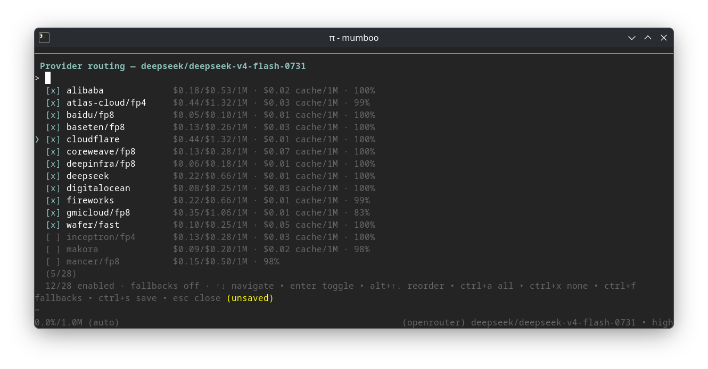

# pi OpenRouter Routing

Pin which providers [pi](https://pi.dev) uses for an OpenRouter model, interactively, from inside the editor.



## Install

```bash
pi install npm:@mumboo/pi-openrouter-routing
```

Or try it without installing:

```bash
pi -e npm:@mumboo/pi-openrouter-routing
```

## Use

Switch to an OpenRouter model, then run `/routing` to pick its providers:

- **↑/↓ + enter** — toggle providers
- **alt+↑/alt+↓** — set priority order
- **ctrl+a / ctrl+x** — enable all / none
- **ctrl+f** — toggle fallbacks (fall back to other providers when pinned ones are unavailable)
- **ctrl+s** — save · **esc** — close

Saves are written to `~/.pi/agent/models.json` and applied to the running session immediately — no restart needed. Hand-set routing fields (e.g. `sort`, `max_price`) are preserved.

## Development

```bash
npm install
npm run check
```

## License

MIT
